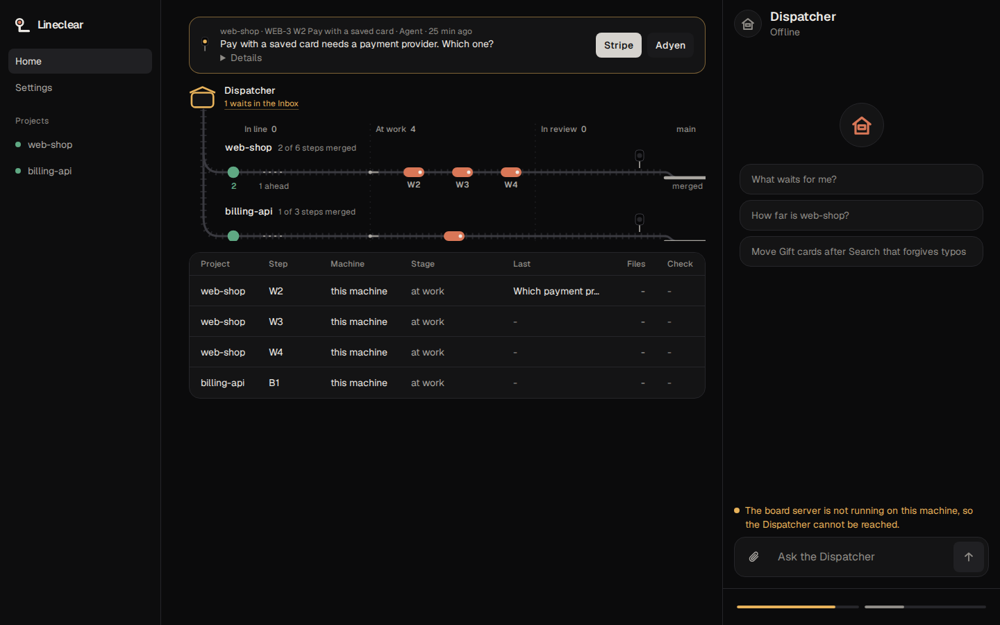

# Lineclear

[](https://github.com/jouni-mikkola/lineclear/actions/workflows/install.yml)

Lineclear is your own software team on your own machines. You talk to one contact and decide only what a human must.

## How it works

- **You** say what you want and answer only what a human must.
- **Roadmap**: a text file in your repo, a line of steps, each named by its result.
- **Rules**: plain code, no AI. They start each step when the one before it has merged.
- **Dispatcher**: the one chat you talk to. It knows which project a request belongs to.
- **Planner**: turns a goal into roadmap steps, each with a why and a done-when.
- **Worker**: builds one step on its own branch and asks for the merge. It never pushes.
- **Reviewer**: an AI from another company than the worker. It checks the change against the step.
- **Inbox**: brings you only a real decision, as a button on your phone.

<p align="center"></p>

Home, on the demo data of `lineclear run --demo`. More views are in [docs/shots](docs/shots/list.md).

## What it needs

- Linux, `curl` and `git`. With systemd user services, Lineclear starts by itself.
- An AI subscription that [pi](https://pi.dev) can use. The install adds Bun, herdr and pi when they are missing.
  pi needs Node.js 22.19 or newer.

## Install

```sh
curl -fsSL https://raw.githubusercontent.com/jouni-mikkola/lineclear/main/install.sh | sh
```

The install puts `lineclear` in `~/.local/bin` and starts `lineclear run` as a user service. Run `lineclear doctor`
to check it; it names any problem and the command that fixes it.

To update, run the install line again. An update that does not work puts the previous version back.
`LINECLEAR_REPO` names another copy of the repository (a URL or a path) and `LINECLEAR_REF` a branch, tag or commit
(default: the machine's stable build once it has one, else `main`). The service runs stable, the last build of main
that passed its tests, never main itself: [Stable and next](docs/stable-and-next.md).

## Status

Works now: the rules that start, review and merge steps by themselves, waits that name their cause, the stall ladder
([stalls](docs/stalls.md)), the Inbox, and the web views (Home, the Dispatcher chat, the Inbox).

Not yet: the own fork (`server/` still follows herdr-projects 2.0) and the merge lane (the merge still runs through the
board). The [roadmap](docs/ROADMAP.md) has both.

## Your first steps

After the install:

1. Log in to a model in pi once: run `pi`, then `/login`. Lineclear uses the models you are logged in to.
2. Add a project: `lineclear project add <repo>`. It asks for the space, check and models it finds by itself. A repo
   with no `docs/ROADMAP.md` gets a first roadmap of at most 8 steps, written from its README and code. Its first step
   then starts by itself.
3. Open `http://127.0.0.1:7420/`. Home shows the line. Tell the Dispatcher what you want at `/chat`. Anything that
   waits for you, such as a login code, money beyond the budget, or a release, arrives in the Inbox at `/inbox`.

The install starts the web pages and the board as user services. On a machine without systemd user services, start
both in a terminal that stays open (in herdr or tmux, say): `lineclear run --board 7421`.

## Remove it

```sh
lineclear uninstall
```

This removes the service, the command, the pi extension and the downloaded code. Git, Bun, herdr and pi stay, since
other things may use them. `lineclear uninstall --all` also removes settings, secrets and the store copies.

## Your task store

Lineclear copies the task store aside every hour (the last 48) and before every update, into
`~/.local/share/lineclear/store-copies`. `lineclear store list` shows the copies, `lineclear store restore <name>` puts one
back. An update that leaves fewer tasks than before is rolled back, and the copy is put back. `lineclear uninstall` keeps the
copies; `--all` removes them.

## More

[The idea](docs/idea.md) · [Roadmap](docs/ROADMAP.md) · [Contributing](CONTRIBUTING.md) · [Changelog](CHANGELOG.md) · [Brand](docs/brand.md)

Lineclear is released under the MIT license ([LICENSE](LICENSE)). It began as a fork of
[herdr-projects 2.0](https://github.com/eliasstravik/herdr-projects), which lives in `server/`.
[server/NOTICE](server/NOTICE) keeps the MIT notice of herdr-projects 2.0.
