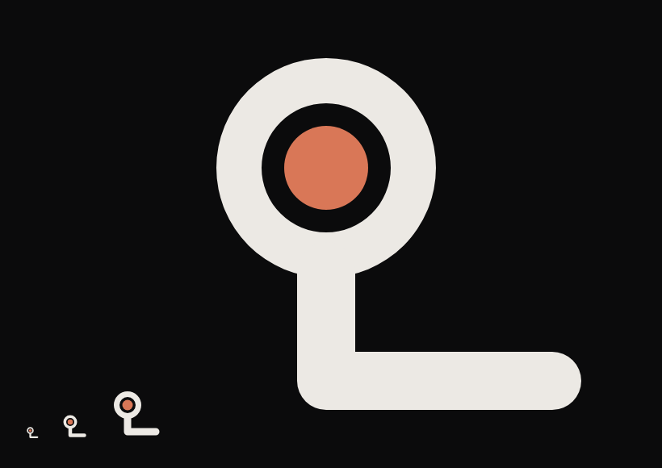
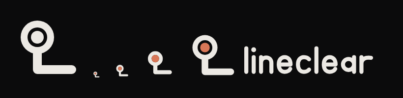
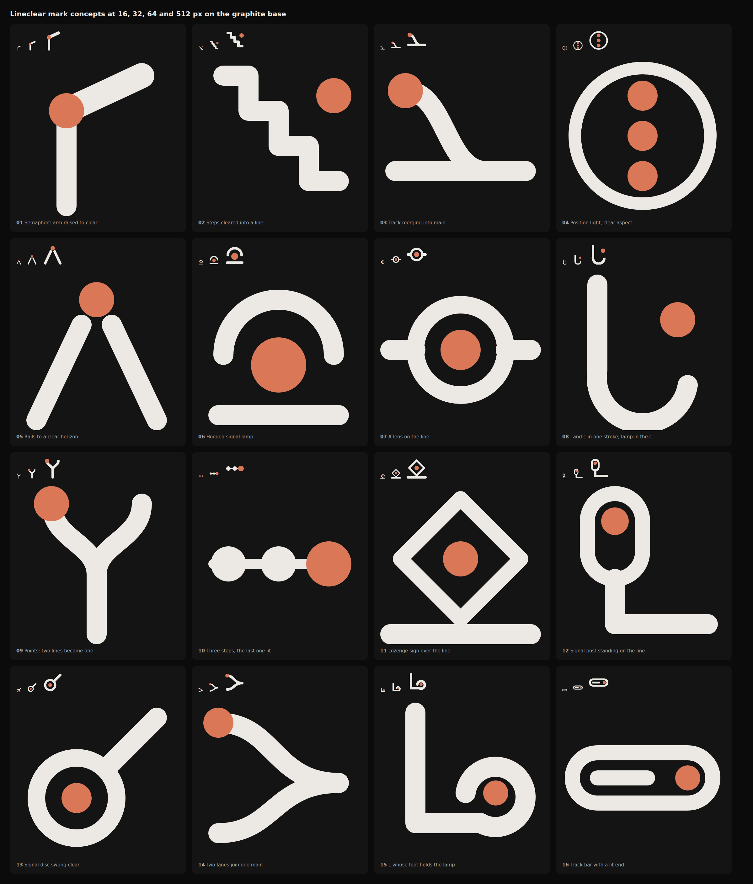
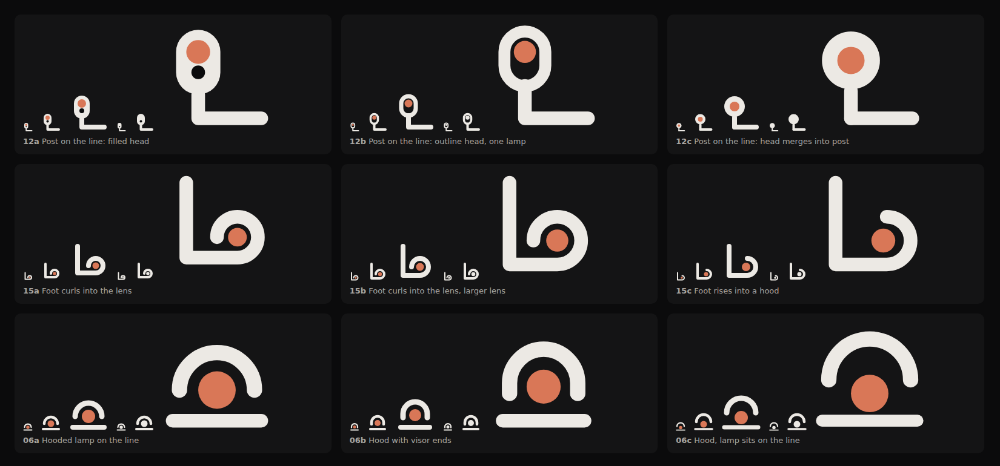
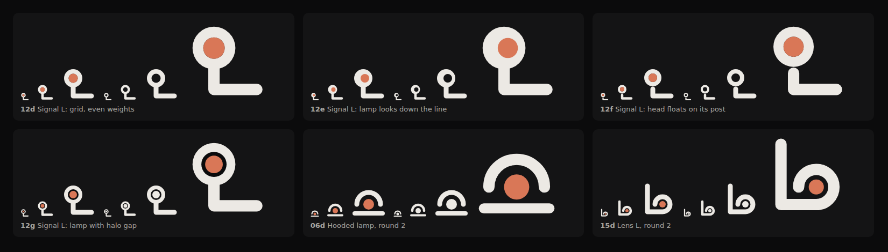
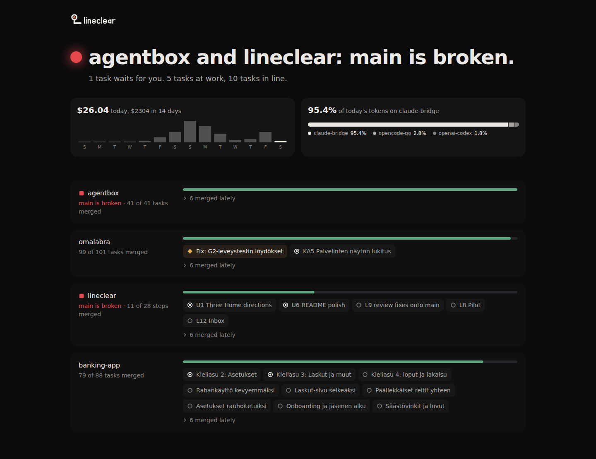
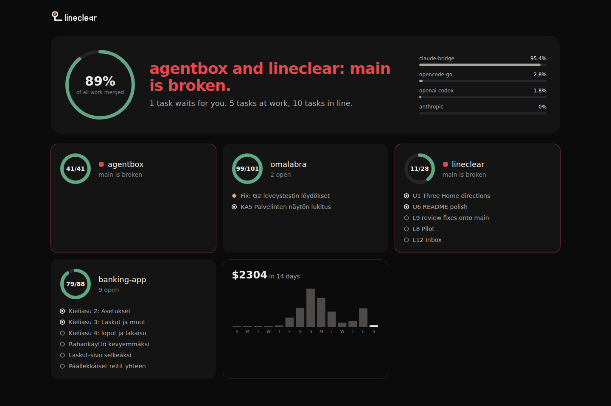
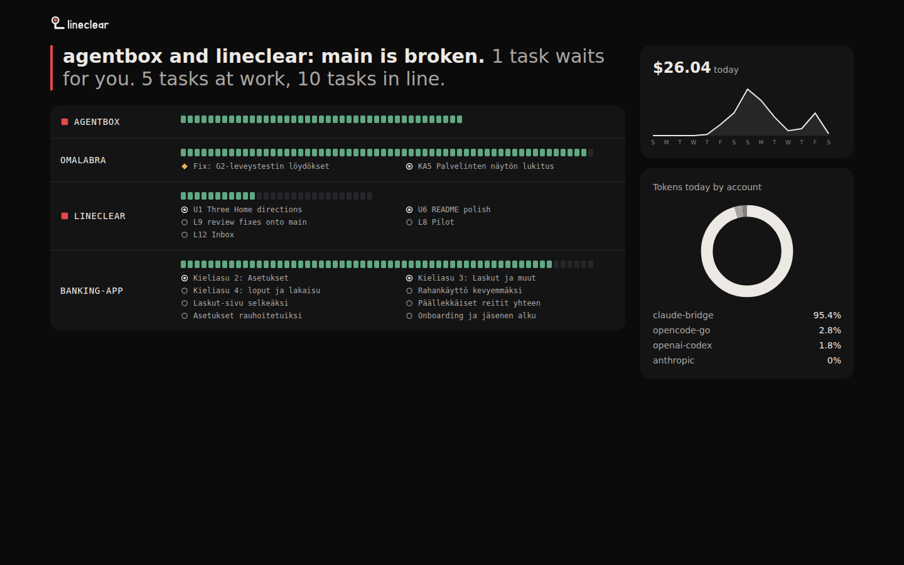

# Brand

## The mark: Signal on the line

Chosen: **Signal on the line**. It is a railway signal and the L of Lineclear in one shape, a lit lamp on a post
that turns onto the line, and it keeps that silhouette at 16 px and in one colour, unlike any check mark or arrow.

The family: one colour version, favicon at 16, 32 and 64 px, and the wordmark.

## How it was chosen

Sixteen concepts from the idea behind the name (a semaphore arm, steps cleared, a track merging into main, signal
aspects, the letter L), each at 16, 32, 64 and 512 px on the graphite base. Their SVG files are in
`docs/brand/concepts/`.

Judged on four tests: reads at 16 px, unique, works in one colour, one memorable idea.

| Concept | Verdict |
|---|---|
| 01 Semaphore arm | Clear idea, but at 16 px it is a bent stick. |
| 02 Steps cleared | A staircase, reads as a chart. |
| 03 Track merging | Good meaning, but reads as a lambda. |
| 04 Position light | A menu icon in a ring. |
| 05 Rails to the horizon | Reads as the letter A. |
| 06 Hooded lamp | Strong at 16 px, but close to a sunrise icon. Finalist. |
| 07 Lens on the line | A target or a git commit node. |
| 08 l and c | The lamp floats free of the letter. |
| 09 Points | A plain Y. |
| 10 Three steps | A progress bar, generic. |
| 11 Lozenge sign | A warning sign, the wrong mood. |
| 12 Signal on the line | Signal and L in one shape. Finalist. |
| 13 Signal disc | Reads as the female symbol. |
| 14 Two lanes | An arrow head. |
| 15 L holds the lamp | Distinct, but reads as "Lo". Finalist. |
| 16 Track bar | A toggle switch. |

Two refinement rounds on the three finalists, on a 64 unit grid with even stroke weights. The second round tried four
heads for the signal; the bezel gap around the lamp (12g) won because it keeps the lamp a separate part in one colour.

## Words

The README, the film, the roles chart, `docs/idea.md` and the app use these words and these pictures, and no others.
The railway is a picture language: it is drawn, never spelled out as a riddle.

| Word | What it is | Its picture | Not these |
|---|---|---|---|
| you | The one who decides: approves plans, answers the Inbox. | a ring with a person | |
| Dispatcher | The one AI chat you talk to, for all your projects. | the signal box | boss, manager, team lead, orchestra |
| plan | The steps the planner writes for a goal, before you approve them. | | |
| planner | The AI model that writes a plan. | | |
| roadmap | The plain text file in your repo that holds the steps and their order. | the line of stations | |
| rules | Plain code, no AI, that starts each ready step. | the points that send a train onto its track | |
| step | One piece of the roadmap, with a why and a done when. | a station | |
| task | The run of one step: its worker, branch and review. Counts of work in progress count tasks. | a train | |
| at work | A task whose worker is building it. | a lit train | steps at work, step at work |
| in line | A task that waits for the rules to start it. | an outline train | |
| waits for you | A decision or a login only you can give. The only amber. | an amber signal | needs you, need you, needing you |
| worker | The AI model that builds one step on its own branch. | a train | does the work |
| reviewer | The AI model from another company that checks a step. | the signal before the junction: grey while it checks, green when clear | |
| Inbox | The one place that asks you, with the answers as buttons. | an amber signal at your place | |
| track | One project. | a track | |
| station | One step on a track. | a ring, filled green once merged | |
| signal | A check or a decision: amber waits for you, green is clear, red only when broken. A review that checks is grey. | a lamp on a mast | |
| main line | A project's main branch. A merge is the junction into it. | the line every track joins | |
| Line clear. | The answer on Home when nothing waits for you and no main is broken. | every signal green | all clear |

Lines, word for word:

- "You talk to one contact. It knows which project each request belongs to, hands the work to AI workers and
  reviewers, and shows you everything live. You only make the decisions."
- "Not tied to one AI company."
- "Claude, Codex, Gemini and others, side by side. When one subscription runs out, the next one takes over."
- "Model-agnostic: you choose the models for each role in Settings."
- "Plain code decides what starts next, so no AI runs while nothing happens."
- "Each worker gets only its step, not the whole history."
- "You decide. The rest runs on its own."
- "Line clear."

Captions state plain facts, calm and dry, like a good product page. Never: slogans, hype words, orders to the
reader, or boss, manager, team lead and orchestra for any role.

## Content

Every text on a view, in the README and in a film follows one rule.

- **It answers a question the user has on that view.** Home: is the line clear? Inbox: what do you need from me? A text that answers none is cut. No filler: no "Welcome", no "Here you can", no "Please".
- **A number comes with its unit and a comparison**: against the limit, yesterday or the median. A space before the unit, as `62 %` and `1 h 20 min`. "Account: Claude, 62 %, resets 21:00", not "62".
- **A time is relative**, such as "in 20 min" or "2 h ago", with the exact time on hover (the `title` of the element).
- **A task goes by its title**, not its id. The id is a small second label where a person must match it to a file.
- **A fact is a label and its value, not a sentence.** A glance reads the value without reading a line.
- **A sentence only where a person must read why**: an error, or a decision in the Inbox.

| Before (a sentence) | After (a label and its value) |
|---|---|
| Sonnet 5.5 does the work | Worker: Sonnet 5.5 |
| Opus 5.5 checks it | Reviewer: Opus 5.5 |
| Claude at 62 % of its limit, resets 21:00 | Account: Claude, 62 %, resets 21:00 |
| It has been running for 1 h 20 min | Running: 1 h 20 min |
| 7 tasks are at work and 3 were merged today | At work: 7 · Merged today: 3 |

A decision keeps its sentence: "Use a paid map service?" with its buttons. An error keeps its reason: "The service stopped. Nothing has started since 19:42."

The words in the glossary above are the only ones for their things. `bun run check` reads the views, the README, the films and the docs, and fails on a word from the last column.

## Voice

Lineclear writes as it draws: plain, concrete and calm. The README, the release notes, the film's captions and the
views follow it, and `bun run check` reads the release notes against the list below, and the README once it
takes its one form (U66).

- Plain words and short sentences. One thing per sentence.
- Concrete: what it does, for whom, with a real example. A number only with its source (`docs/numbers.md`).
- Say each thing once, where it is acted on. No line that repeats a count shown elsewhere, no subtitle that
  restates what the page is, no slogan where a part is empty, and never a command for the reader to run in the app.
- No AI phrasing: no hype, no filler, no grand openings, no "not just X, but Y".

Never written (the check's list, one per line):

<!-- voice:never -->
- seamless
- effortless
- unlock
- supercharge
- empower
- elevate
- leverage
- harness the
- delve
- unleash
- game-changer
- cutting-edge
- revolutionize
- next-generation
- world-class
- powerful
- robust
- streamline
- magic
- in today's
- it's worth noting
- let's dive
- not just
- Nothing to carry yet
- things wait for you
- How it works
<!-- /voice:never -->

## The board

[design/board.html](design/board.html) is the target of every view: one mock per view at 1440 and 390 px, with its
parts, its motion and every state. Phase 13 builds to it. Its rules:

- **One answer per view**, and the next tap is next to it.
- **Colour.** Graphite base, raised cards, a 1 px line, no shadows but the toast, and only the colours in
  `tokens.css`. Green is clear, amber waits for you, red only broken. The orange accent is the brand (the mark, the
  focus ring, the selected tab), never a state and never a button's fill: the primary button is `--lc-action`. A review that checks is a grey lamp, so amber always means you.
- **Type.** One family and the scale in `tokens.css`, no new sizes: 48 the answer, 32 a view title on a phone, 22 a
  detail title, 18 a card or section title, 16 body, 14 rows, 12 meta. Numbers are tabular.
- **Grid.** A 4 px unit. A desktop has a rail of 232 px and content up to 1128 px on 12 columns; from 1920 px a side
  panel of 400 px. A phone has 16 px margins, 48 px targets and a bottom bar of five.
- **Motion** explains a change and never decorates: press 100 ms, hover 120 ms, a lamp 200 ms, lists and panels
  240 ms, a view change 280 ms the way you went, a train 240 ms on a real change only. Each stays under 300 ms (U2),
  plays once, keeps input free, and shows only the end state under reduced motion. Two things loop, and only while
  they last: loading lays the track at U24's time while data is missing, and a lamp that waits on someone blinks
  slowly while a review checks or something waits for you.

## Picture language

The one set of pictures every view, the README and the films draw from. The words stay plain: a caption says "at
work" or "waits for you", never "train" or "signal". The picture carries the theme.

| Thing | Picture | Its states |
|---|---|---|
| a project | a track | laid while it loads |
| a step | a station on the track | dim ahead, lit when it is next, white while a train is at it, amber when it asks, filled green once merged |
| a task at work | a train moving on its track | lit at work, an outline in line, dashed when no sign of life |
| review | the signal before the junction | grey while it checks, green when clear, so amber always means you |
| merged | the train joins the main line | the station turns green |
| waits for you | an amber signal | green once you answer, and the train moves on |
| broken | a red signal on the main line | the only red there is |
| a free task slot on a machine | an empty siding | a train in it while a task works there |
| an account and its model | an engine | its share of the day's tokens in %, its spend in $ |
| the Dispatcher | the signal box | grey dots while it writes, since amber is only for you |
| the rules | the points | set for each step that is ready |

Where each view uses them:

- Home: the live line. A track per project, a train per task at work, a signal per review, a station that turns
  green on a merge, a short pulse on news.
- Roadmap: the project's track with its stations in phase groups. Done stations are filled, the next one is lit,
  steps that run side by side are side tracks that split off and join again.
- Inbox: each ask is an amber signal. Answering turns it green and its train pulls away.
- Chat: the Dispatcher is the signal box. A request it hands on is drawn going to its project's track.
- Settings: a machine's task slots are sidings with trains in the busy ones; accounts are the engines.
- Agent browsers: the same parts, no new symbols.

Motion explains a change and nothing else: a train moves because its task moved, a lamp changes because its state
did. Times and easings are the motion tokens in `ui/brand/rail.ts` (200, 240 and 280 ms, one loop of 1.4 s while
a part loads), the same for the views and the README's films. Under reduced motion every picture shows its final
state and nothing moves.

The parts are data in `ui/brand/rail.ts` (track, station, train, signal, main line, siding, engine, signal box).
`ui/kit/rail.tsx` draws them in the views, `scripts/film/line.py` in the README's film (in 3D, in Blender). The
README's chart of who does what (`scripts/readme-roles.ts`) uses the role icons and the same station for main.
Green is clear, amber is only what waits for you, red is only a broken main.

## Files

All in `ui/brand/`. There is one theme only, the dark graphite one. U2 added sizes for type and spacing to the tokens ([design.md](design.md)).

| File | Use |
|---|---|
| `mark.svg` | The mark: head and line in `--lc-fg`, the lamp in `--lc-accent`. |
| `mark-mono.svg` | One colour, for places with a single ink. |
| `wordmark.svg` | The mark with "lineclear". |
| `ui/kit/rail.tsx` `EmptyTrack`, `LaidTrack` | Not a file in `ui/brand/`: the laid track is the loading state and the bare track the empty state, drawn in code from `rail.ts`. No view uses the mark for either. |
| `favicon.svg` | The mark on a graphite tile, heavier and with the lamp filling the bezel (no gap), so it holds at 16 px on light tab bars too. |
| `tokens.css` | The tokens: colours, type, spacing and corners. |

## Pictures

The README shows stills from `bun run shots`. The hand-drawn brand pictures stay in `docs/brand/`.

## Home: The line

Chosen: **The line**. Each project is one track that fills green as its steps merge, which is the roadmap carried to
main in one glance and the same line as the mark, and it stays calm at 200 tasks where dials and block rows get loud.

Three directions were drawn at 1440 px on the U0 tokens, and the prototype that held them is gone:

| Direction | Verdict |
|---|---|
| The line | One answer, two charts, a track per project with its open tasks as shapes. Chosen. |
| Signal box | A dial per project reads well, but dials compete with the answer and waste width. |
| Timetable | Dense and fun, but monospace rows and a block per task turn noisy, and the donut hides small accounts. |

These are drawings of the three directions, not screenshots of the app. The app's own screenshots are in `docs/shots/`.

The chosen one is the Home of the app. Its empty, loading, error, long text and 200 items states at 1440 and 390 px are the screenshot tests `ui/test/screens/home-<state>-<width>.png` (`empty`, `loading`, `error`, `long`, `many`). Its task starting and finishing are the recordings `docs/design/motion/home-task-start.webm` and `home-task-finish.webm`, and `bun run ui:test` holds their 60 fps, instant click and reduced-motion bars.
